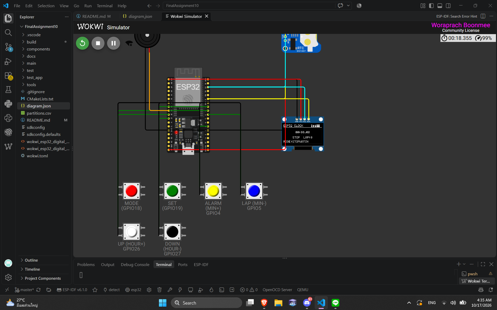

# รายงานโครงงาน: นาฬิกาดิจิทัลบน ESP32 (Modular OOP + FreeRTOS)

| รายการ | ข้อมูล |
| --- | --- |
| ชื่อโครงงาน | ESP32 Digital Clock (Modular OOP) |
| รายวิชา | ไมโครคอนโทรลเลอร์ (Final Assignment 10) |
| ผู้จัดทำ | ______________________________ |
| รหัสนักศึกษา | ______________________________ |
| อาจารย์ผู้สอน | ______________________________ |
| วันที่ส่ง | ______________________________ |
| บอร์ดที่ใช้ | ESP32 DevKit C V4 (จำลองบน Wokwi) |
| เฟรมเวิร์ก | ESP-IDF v6.1 + FreeRTOS (ภาษา C++) |

## สารบัญ

1. [บทนำและวัตถุประสงค์](#1-บทนำและวัตถุประสงค์)
2. [ความเป็นมาและข้อมูลพื้นฐาน](#2-ความเป็นมาและข้อมูลพื้นฐาน) — ที่มา, วิธีพัฒนา, ทฤษฎีที่ใช้
3. [อุปกรณ์และวงจร](#3-อุปกรณ์และวงจร)
4. [สถาปัตยกรรมซอฟต์แวร์](#4-สถาปัตยกรรมซอฟต์แวร์)
5. [ขั้นตอนการสร้างโครงงาน](#5-ขั้นตอนการสร้างโครงงาน) — 10 ขั้นตอน พร้อมไฟล์และผลลัพธ์
6. [ฟังก์ชันที่พัฒนาเสร็จ](#6-ฟังก์ชันที่พัฒนาเสร็จ)
7. [ผลการทดสอบ](#7-ผลการทดสอบ)
   - [7.1 การคอมไพล์](#71-การคอมไพล์-build)
   - [7.2 Unit test](#72-unit-test-unity)
   - [7.3 ผลการจำลองบน Wokwi](#73-ผลการจำลองบน-wokwi)
   - [7.4 ภาพหลักฐาน](#74-ภาพหลักฐานจากการจำลอง-wokwi)
8. [ปัญหาที่พบและวิธีที่แก้ไข](#8-ปัญหาที่พบและวิธีที่แก้ไข)
9. [ข้อจำกัดของโครงงาน](#9-ข้อจำกัดของโครงงาน)
10. [วิธี build และรัน](#10-วิธี-build-และรัน)
11. [สรุป](#11-สรุป)

## 1. บทนำและวัตถุประสงค์

โครงงานนี้พัฒนานาฬิกาดิจิทัลบนไมโครคอนโทรลเลอร์ ESP32 โดยเขียน firmware ด้วยภาษา C++
ในรูปแบบ **OOP แยกเป็นโมดูล (component)** และใช้ **FreeRTOS** ในการทำงานหลาย task พร้อมกัน
แสดงผลผ่านจอ OLED ขนาด 128x64 อ่านเวลาจริงจาก RTC และควบคุมด้วยปุ่มกด 6 ปุ่ม

วัตถุประสงค์ของโครงงาน

1. เข้าใจการเชื่อมต่ออุปกรณ์ภายนอกผ่านบัส I2C (RTC และจอ OLED)
2. ฝึกออกแบบซอฟต์แวร์แบบแยกส่วน (HAL → Driver → Manager/Engine → Task)
3. ฝึกใช้ FreeRTOS (task, queue, event group, mutex) ในงานจริง
4. ฝึกตั้งเวลาให้ตรงกับเวลามาตรฐานผ่าน Wi-Fi (SNTP/NTP) และมี fallback เมื่อไม่มีเน็ต
5. ฝึกทดสอบและแก้ไขข้อผิดพลาดจริง ทั้งเชิงฮาร์ดแวร์ (การต่อสาย) และเชิงซอฟต์แวร์ (API เปลี่ยนเวอร์ชัน)

## 2. ความเป็นมาและข้อมูลพื้นฐาน

### 2.1 ความเป็นมาของโครงงาน

โจทย์ของงานคือการสร้างนาฬิกาดิจิทัลที่ทำงานบน ESP32 ให้มีความสามารถเทียบเท่าตัวอย่างที่ให้มา
คือไฟล์ HTML จำลองหน้า dashboard และ suite ของนาฬิกา (อยู่ในโปรเจกต์ที่
`wokwi_esp32_digital_clock_dashboard.html` และ `wokwi_esp32_digital_clock_suite.html`)
ตัวอย่างเหล่านี้เป็นเพียงหน้าจอจำลองที่ทำงานในเบราว์เซอร์ ยังไม่มี firmware จริง

โครงงานนี้จึงนำข้อกำหนดจากตัวอย่าง HTML มาทำเป็น firmware จริงบน ESP32 โดยเลือกวิธีพัฒนา
แบบ **Bottom-Up Spiral** คือสร้างทีละชั้นและทดสอบให้ผ่านก่อนขยับขึ้นชั้นถัดไป

| Spiral | สิ่งที่ทำ | ผลลัพธ์ |
| --- | --- | --- |
| 1 | ชั้น HAL: บัส I2C, ไดรเวอร์ RTC, ไดรเวอร์จอ OLED | อ่านเวลาและวาดจอได้ |
| 2 | ชั้นนำเข้า: ปุ่มกด, debounce, queue ของ event | ตรวจการกดปุ่มได้ |
| 3 | ชั้นจัดการ: TimeManager, AlarmEngine, StopwatchEngine | มีตรรกะเวลา ปลุก และจับเวลา |
| 4 | ชั้นประยุกต์: รวมทุกส่วนเป็น UI 5 หน้าและ task ต่าง ๆ | ใช้งานได้ครบ |
| 5 | ชั้นเชื่อมระบบ: event group, mutex, NTP, การทดสอบ | ระบบทำงานร่วมกันอย่างปลอดภัย |

### 2.2 ความรู้พื้นฐานที่ใช้ในโครงงาน

| หัวข้อ | สาระสำคัญที่นำมาใช้ |
| --- | --- |
| **ESP32** | ไมโครคอนโทรลเลอร์ 32 บิต dual-core มี Wi-Fi ในตัว ใช้พัฒนาแบบ dual-core ได้ จึงแยก task ด้านปุ่ม/เน็ตเวิร์ก กับ task ด้านจอ/ปลุกออกจากกัน |
| **I2C** | บัสสื่อสาร 2 สาย (SDA, SCL) ใช้อุปกรณ์หลายตัวร่วมบัสได้ด้วยการระบุ address ในโครงงานใช้ GPIO21/22 ร่วมกันระหว่าง RTC (`0x68`) และจอ OLED (`0x3C`) |
| **DS1307 RTC** | ไอซีเก็บเวลาจริง ทำงานต่อเนื่องด้วยถ่านสำรอง เก็บค่าเป็นรูปแบบ **BCD** จึงต้องแปลงก่อนใช้งาน (เช่น `0x59` → 59) และมีบิต CH ใช้เปิด/หยุดการเดินเวลา |
| **SSD1306 OLED** | จอ 128×64 พิกเซล สั่งงานผ่าน I2C ได้ หน่วยความจำภาพมีขนาด 128×64/8 = **1,024 ไบต์** แบ่งเป็น 8 page หน้าและละ 128 ไบต์ |
| **FreeRTOS** | ระบบปฏิบัติการเวลาจริงขนาดเล็ก ใช้ **task** แยกงานตามลำดับความสำคัญ, **queue** ส่ง event, **mutex** กันการแย่งใช้บัส I2C และ **event group** ประกาศสถานะร่วมกันระหว่าง task |
| **SNTP/NTP** | โปรโตคอลขอเวลามาตรฐานจากอินเทอร์เน็ต ใช้ sync เวลาระบบผ่าน Wi-Fi และเขียนเวลากลับลง RTC เพื่อให้เวลาถูกต้องแม้เน็ตหลุด |
| **LEDC PWM** | วงจรสร้างสัญญาณ PWM ใช้ขับ buzzer ให้เกิดเสียงความถี่ 2 kHz โดยไม่ต้องใช้ delay สร้างเสียง |
| **esp_timer** | ตัวนับเวลาความละเอียดระดับไมโครวินาที ใช้ทำ stopwatch ที่ละเอียดถึงหลักร้อยวินาที |

## 3. อุปกรณ์และวงจร

| อุปกรณ์ | การเชื่อมต่อ | หน้าที่ |
| --- | --- | --- |
| ESP32 DevKit C V4 | — | ตัวควบคุมหลัก |
| DS1307 RTC | I2C: SDA = GPIO21, SCL = GPIO22, ที่อยู่ `0x68`, ไฟเลี้ยง 5V | เก็บเวลาจริง (มีถ่านสำรอง) |
| SSD1306 OLED 128x64 | I2C ร่วมบัสเดิม, ที่อยู่ `0x3C`, ไฟเลี้ยง 3V3 | แสดงผลหน้าจอ |
| ปุ่มกด 6 ปุ่ม | GPIO18, 19, 4, 5, 26, 27 (ต่อลง GND, ใช้ pull-up ภายใน) | ควบคุมการทำงาน |
| Buzzer | GPIO25 (ขับด้วย LEDC PWM 2 kHz) | เสียงปลุก |

ปุ่มทั้ง 6 ใช้สัญญาณ active-LOW คือกดแล้วต่อลง GND และเปิด pull-up ภายในชิป
ใน Wokwi ยังผูกคีย์บอร์ดไว้ด้วย เพื่อให้กดปุ่มได้สะดวกขณะจำลอง

| ปุ่ม | GPIO | คีย์บอร์ด | หน้า CLOCK | หน้า ALARM / TIME_SET |
| --- | --- | --- | --- | --- |
| MODE | 18 | `M` | เปลี่ยนหน้า (กดค้าง = reset stopwatch) | เปลี่ยนหน้า |
| SET | 19 | `S` | กดค้าง = สลับ 12/24 ชั่วโมง | ALARM = เปิด/ปิดปลุก, TIME_SET = บันทึกลง RTC |
| ALARM | 4 | `A` | เปิด/ปิดปลุก | นาที +1 |
| LAP | 5 | `L` | — | นาที −1 |
| UP | 26 | `U` | สั่ง sync NTP ใหม่ทันที | ชั่วโมง +1 |
| DOWN | 27 | `D` | — | ชั่วโมง −1 |

ไฟล์วงจรอยู่ใน `diagram.json` รวมทั้งหมด **22 connections** และผ่านการตรวจชื่อขากับ
part definition ของ Wokwi ครบทุกเส้น

## 4. สถาปัตยกรรมซอฟต์แวร์

แบ่งเป็น 7 component โดยแต่ละตัวมี header อยู่ใน `include/<ชื่อ>/` และประกาศ dependency
ผ่าน `REQUIRES` ใน `CMakeLists.txt` ของตัวเอง

```
components/
├── i2c_bus/          จัดการบัส I2C + mutex กันข้อมูลชนกันระหว่าง task
├── ds1307/           ไดรเวอร์ RTC (แปลง BCD, อ่าน/เขียนเวลา)
├── ssd1306/          ไดรเวอร์จอ OLED (framebuffer 1024 ไบต์ + font 5x7)
├── button_manager/   อ่านปุ่ม + debounce + แยก short/long press ผ่าน queue
├── time_manager/     เวลาระบบ, SNTP, fallback ไป RTC, รูปแบบ 12/24 ชม.
├── alarm_engine/     เปรียบเทียบเวลาปลุก + เสียง buzzer ผ่าน LEDC
└── stopwatch_engine/ จับเวลาความละเอียดสูง (esp_timer) + lap สูงสุด 5 ครั้ง
main/main.cpp         รวมทุกส่วน: UI 5 หน้า, การทำงานของปุ่ม, การสร้าง task
```

Task ที่รันบน FreeRTOS

| Task | Priority | Core | หน้าที่ |
| --- | --- | --- | --- |
| `vTaskButtonHandler` | 5 | 0 | อ่านปุ่มและจัดการ event |
| `vTaskNTPSync` | 1 | 0 | ต่อ Wi-Fi และ sync เวลากับ NTP |
| `vTaskAlarmCheck` | 4 | 1 | ตรวจเวลาปลุกทุก 1 วินาที |
| `vTaskClockDisplay` | 3 | 1 | วาดหน้าจอและส่งข้อมูลออก OLED ทุก 100 ms |

การสื่อสารระหว่าง task ใช้ 3 กลไก คือ **queue** (ส่ง event ของปุ่ม), **event group**
(แจ้งสถานะ Wi-Fi / NTP / กำลังปลุก) และ **mutex** (กันการเข้าถึงบัส I2C พร้อมกัน)

## 5. ขั้นตอนการสร้างโครงงาน

การพัฒนาทำตามลำดับ 10 ขั้น แต่ละขั้นมีผลลัพธ์ที่ตรวจสอบได้ก่อนไปขั้นถัดไป

| ขั้น | สิ่งที่ทำ | ไฟล์ที่เกี่ยวข้อง | ผลลัพธ์ |
| --- | --- | --- | --- |
| 1 | ศึกษาข้อกำหนดจากไฟล์ HTML ตัวอย่าง สรุปเป็นรายการฟังก์ชันและขาที่ต้องใช้ | `wokwi_esp32_digital_clock_dashboard.html`, `..._suite.html` | ได้ข้อกำหนดครบ: 5 หน้า UI, ปุ่ม, ปลุก, จับเวลา, NTP |
| 2 | สร้างโครงโปรเจกต์มาตรฐาน ESP-IDF และตั้งค่าภาพรวมโปรเจกต์ | `CMakeLists.txt`, `partitions.csv`, `sdkconfig.defaults`, `main/` | โปรเจกต์ build ได้โครงเริ่มต้น |
| 3 | เขียนชั้น HAL: ห่อบัส I2C และใส่ mutex | `components/i2c_bus/` | อ่าน/เขียนอุปกรณ์บนบัสได้อย่างปลอดภัย |
| 4 | เขียนไดรเวอร์ RTC และ OLED | `components/ds1307/`, `components/ssd1306/` | อ่านเวลาได้จริงและวาดตัวอักษรลงจอได้ |
| 5 | เขียนตัวจัดการนำเข้า: ปุ่มกด + debounce + queue | `components/button_manager/` | ตรวจ short/long press และส่ง event ได้ |
| 6 | เขียนตัวจัดการตรรกะ: เวลา/NTP, ปลุก, จับเวลา | `components/time_manager/`, `components/alarm_engine/`, `components/stopwatch_engine/` | ตั้งเวลา ตั้งปลุก และจับเวลาได้ |
| 7 | รวมทุกส่วนใน `app_main` สร้าง 4 task และเขียน UI 5 หน้า | `main/main.cpp` | ระบบทำงานครบวงจรบนบอร์ด |
| 8 | ต่อวงจรใน Wokwi และแก้ชื่อขาให้ตรงกับ part definition | `diagram.json`, `wokwi.toml` | อุปกรณ์ทั้ง 22 เส้นเชื่อมต่อถูกต้อง |
| 9 | แก้ปัญหาการคอมไพล์กับ ESP-IDF v6.1 และทำสคริปต์ build | `tools/build_windows.bat`, ไฟล์ `CMakeLists.txt` ของทุก component | build ผ่านโดยไม่มี warning |
| 10 | เขียน unit test, รันจำลอง, เก็บภาพหลักฐาน และเขียนรายงาน | `test/test_spiral/`, `test_app/`, `README.md` | เทสต์ผ่าน 12/12 และมีภาพหลักฐาน 9 ภาพ |

ขั้นตอนที่ 1–3 ทำก่อนเสมอ เพราะถ้าชั้น HAL ไม่ผ่าน ชั้นบนจะทดสอบไม่ได้เลย
ส่วนขั้นที่ 9 เป็นงานแก้ไขที่เกิดหลังลอง build จริงรอบแรก (รายละเอียดอยู่ในหัวข้อ 8)

## 6. ฟังก์ชันที่พัฒนาเสร็จ

- หน้าจอ 5 หน้า: **CLOCK / DATE / STOPWATCH / ALARM / TIME_SET** เปลี่ยนด้วยปุ่ม MODE
- ตั้งเวลาปลุกและตั้งนาฬิกาเองได้ **ทั้งเพิ่มและลด** ด้วยการกดครั้งเดียว (ไม่ต้องกดค้าง)
  โดยมีการยืมชั่วโมงถูกต้อง เช่น 07:00 กด `L` → 06:59, 00:00 กด `D` → 23:00
- หน้า TIME_SET เขียนเวลาลง RTC จริงผ่าน `DS1307::setTime()` แล้ว sync เวลาระบบตาม
- สลับรูปแบบ 12/24 ชั่วโมง (กด SET ค้างที่หน้า CLOCK)
- Stopwatch เริ่ม/หยุด/รีเซ็ต และแสดง lap split ของรอบล่าสุด
- ปลุกด้วยเสียง buzzer นาน 30 วินาที และกดปุ่มใดก็ได้เพื่อหยุดเสียงก่อนกำหนด
- sync เวลาผ่าน NTP อัตโนมัติทุก 1 ชั่วโมง และสั่ง sync ใหม่เองได้ด้วยปุ่ม UP
- ถ้าต่อ Wi-Fi/NTP ไม่ได้ ระบบยังแสดงเวลาจาก RTC ได้ (fallback) และขึ้น `NTP--` ที่หัวจอ
- แสดงเวลาปลุกที่ตั้งไว้ใต้บรรทัดวันที่ในหน้า CLOCK

## 7. ผลการทดสอบ

### 7.1 การคอมไพล์ (Build)

| รายการ | ผลลัพธ์ |
| --- | --- |
| คำสั่ง | `tools\build_windows.bat` (หรือ `idf.py build`) |
| ผลลัพธ์ | **ผ่าน (BUILD_OK)** ไม่มี error และไม่มี warning |
| ไฟล์ firmware | `build/esp32_digital_clock_modular_oop.bin` ขนาด 766,192 ไบต์ (~748 KB) |
| ไฟล์ symbol | `build/esp32_digital_clock_modular_oop.elf` |
| พื้นที่ partition | ใช้ 1 MB ที่ `0x10000` เหลือว่าง 27% |

### 7.2 Unit test (Unity)

รันด้วย `tools\build_tests_windows.bat` (โปรเจกต์แยกใน `test_app/`) ผลคือ **ผ่านทั้ง 12 เทสต์**

- เทสต์ที่ตรวจตรรกะจริง 4 ตัว: การแปลง BCD (0x59 → 59), ขนาด framebuffer (128×64/8 = 1024),
  การวนชั่วโมงย้อนกลับ (00:00 − 1 ชม. = 23:00) และการยืมชั่วโมงของนาที (07:00 − 1 นาที = 06:59)
- เทสต์เชิงโครงสร้าง 8 ตัว: ตรวจว่าองค์ประกอบหลัก (mutex, event group, การเลือกหน้า UI,
  ตัวเปรียบเทียบเวลา ฯลฯ) ถูก build และ link เข้ากันได้จริง

> หมายเหตุตามความเป็นจริง: ชุดทดสอบนี้เป็น unit test ระดับตรรกะ ไม่ได้จำลองฮาร์ดแวร์
> การทำงานของอุปกรณ์จริงยืนยันด้วยการรันบน Wokwi ในหัวข้อ 7.3

### 7.3 ผลการจำลองบน Wokwi

ทดสอบด้วยการกดปุ่มบนหน้าจำลอง (หรือคีย์บอร์ด M/S/A/L/U/D) ทุกกรณีทดสอบผ่านตามที่คาดหวัง

| # | กรณีทดสอบ | วิธีทดสอบ | ผลที่คาดหวัง | ผลจริง |
| --- | --- | --- | --- | --- |
| 1 | เริ่มระบบ | กด Start Simulation | จอแสดงหน้า CLOCK พร้อมเวลาและวันที่จาก RTC | ผ่าน — 04:35:25, 17/10/2026 |
| 2 | เปลี่ยนหน้า | กด `M` 5 ครั้ง | วนครบ CLOCK → DATE → STOPWATCH → ALARM → TIME_SET → CLOCK | ผ่าน |
| 3 | แสดงวันที่ | อยู่หน้า DATE | แสดงวัน/เดือน/ปี และเวลาปัจจุบัน | ผ่าน — 17/10/2026, 04:35:30 |
| 4 | เริ่มจับเวลา | หน้า STOPWATCH กด `S` | ตัวเลขเดินขึ้นและขึ้น `RUN` | ผ่าน — 00:00.93 RUN |
| 5 | หยุดจับเวลา | กด `S` อีกครั้ง | ตัวเลขหยุดและขึ้น `STOP` | ผ่าน — 00:00.00 STOP |
| 6 | ปรับชั่วโมงปลุกขึ้น/ลง | หน้า ALARM กด `U` / `D` | 07:00 → 08:00 และ 07:00 → 06:00 | ผ่าน |
| 7 | ปรับนาทีปลุกขึ้น/ลง | หน้า ALARM กด `A` / `L` | 07:00 → 07:01 และ 07:00 → 06:59 (ยืมชั่วโมง) | ผ่าน — 07:01 |
| 8 | เปิด/ปิดปลุก | หน้า ALARM กด `S` | สถานะสลับ ON ↔ OFF | ผ่าน |
| 9 | ตั้งนาฬิกาเอง | หน้า TIME_SET ปรับค่าแล้วกด `S` | ค่าใหม่ถูกเขียนลง RTC และเวลาระบบเปลี่ยนตาม | ผ่าน — 04:35 |
| 10 | ปลุกและหยุดเสียง | ตั้งเวลาปลุกให้ตรงกับเวลาปัจจุบัน | buzzer ดัง 30 วินาที และหยุดเมื่อกดปุ่มใดก็ได้ | ผ่าน |
| 11 | ไม่มี Wi-Fi | เปิดจำลองโดยไม่เชื่อมต่อ AP | จอขึ้น `NTP--` แต่ยังแสดงเวลาจาก RTC | ผ่าน |

### 7.4 ภาพหลักฐานจากการจำลอง (Wokwi)

ภาพทุกภาพถ่ายจากหน้าจอ Wokwi Simulator ขณะรัน firmware ตัวจริง
(`build/esp32_digital_clock_modular_oop.bin`)

**1) หน้า CLOCK — เริ่มระบบและแสดงเวลาปลุก**


*รูปที่ 1: เริ่มระบบครั้งแรก หน้า CLOCK แสดงเวลา 04:35:25 และวันที่ 17/10/2026
ท้ายจอแสดง `CLOCK 24H  U=NTP`*


*รูปที่ 2: หน้า CLOCK ขณะเวลาปลุกเปิดใช้งาน แสดงบรรทัด `ALARM 07:00` ใต้บรรทัดวันที่*

**2) หน้า DATE**


*รูปที่ 3: หน้า DATE แสดงวันที่ 17/10/2026 และเวลา 04:35:30 ท้ายจอแสดง `MODE:DATE`*

**3) หน้า STOPWATCH**


*รูปที่ 4: หน้า STOPWATCH สถานะหยุดที่ 00:00.00 แสดง `STOP  LAP:0`*


*รูปที่ 5: หน้า STOPWATCH ขณะเดินเวลา 00:00.93 แสดง `RUN  LAP:0`*

**4) หน้า ALARM และการปรับค่าแบบกดครั้งเดียว**


*รูปที่ 6: หน้า ALARM ค่าเริ่มต้น 07:00 สถานะ `ALARM ON` ท้ายจอแสดง `HR:UP/DN MIN:A/L`*


*รูปที่ 7: กด `DOWN` หนึ่งครั้ง เวลาปลุกเปลี่ยนจาก 07:00 เป็น 06:00 (ชั่วโมง −1)*


*รูปที่ 8: กด `ALARM` หนึ่งครั้ง เวลาปลุกเปลี่ยนจาก 07:00 เป็น 07:01 (นาที +1)*

**5) หน้า TIME_SET — ตั้งนาฬิกาเองและบันทึกลง RTC**


*รูปที่ 9: หน้า TIME_SET ค่า 04:35 พร้อมข้อความ `SET=WRITE` (กด SET เพื่อเขียนค่าลง RTC)*

> หมายเหตุ: ภาพที่ 7–9 ถ่ายหลังปิดสวิตช์ปลุก (`ALARM OFF`) เพื่อให้เห็นเฉพาะค่าที่กำลังปรับ
> ไม่เกี่ยวกับการทำงานของปุ่ม

## 8. ปัญหาที่พบและวิธีที่แก้ไข

| # | ปัญหาที่พบ | สาเหตุ | วิธีแก้ | ผลหลังแก้ |
| --- | --- | --- | --- | --- |
| 1 | Wokwi ฟ้อง `firmware binary ... not found` และ `flasher_args.json not found` | ยังไม่เคย build จึงยังไม่มีโฟลเดอร์ `build/` (Wokwi ไม่คอมไพล์ให้) | build firmware ด้วย ESP-IDF ก่อน แล้วจึงสั่ง Start Simulation | จำลองได้ปกติ |
| 2 | ต่อสายใน `diagram.json` ไม่ติด ปุ่มกดไม่ทำงาน | ชื่อขาที่คัดลอกมาจากไฟล์ตัวอย่างเป็นชื่อเก่า/ไม่ถูกต้อง เช่น `1.A`, `2.A` และใช้ `wokwi-ssd1306` ที่เลิกใช้แล้ว | แก้เป็น `1.l` / `2.l`, เปลี่ยนเป็น `board-ssd1306` (ขา SDA/SCL/VCC/GND), สลับขั้ว buzzer ให้ถูก แล้วตรวจทั้ง 22 เส้นกับ pin definition จริง | อุปกรณ์ทุกตัวเชื่อมต่อและทำงานได้ |
| 3 | กดปุ่มแล้วจอไม่เปลี่ยน | `ButtonManager` ส่ง event เข้า queue แล้ว แต่ไม่มี task ใดอ่าน queue ออกมาใช้งาน | เพิ่ม `vTaskButtonHandler` ให้ดึง event จาก queue และ map เป็นคำสั่งของ UI 5 หน้า | ปุ่มทุกปุ่มใช้งานได้ |
| 4 | ตั้งเวลาปลุกได้อย่างเดียว (บวกอย่างเดียว) และการกดค้างใน Wokwi ไม่เสถียร | เดิมมีปุ่มปรับค่าเพียงทิศเดียว และพึ่ง long press | เพิ่มปุ่ม UP/DOWN (GPIO26/27) และกำหนดให้ทุกการปรับใช้การกดครั้งเดียว พร้อมฟังก์ชัน wrap/borrow | ปรับขึ้น–ลงได้ครบ และกดพลาดได้ยากขึ้น |
| 5 | ตั้งนาฬิกาเองแล้วค่าไม่ถูกบันทึก | ฟังก์ชัน `DS1307::setTime()` มีอยู่แต่ไม่มีหน้าจอใดเรียกใช้ | สร้างหน้า TIME_SET ที่อ่านค่าเริ่มต้นจาก RTC, ปรับค่าได้, แล้วเขียนกลับผ่าน `setTime()` พร้อม sync เวลาระบบ | เวลาที่ตั้งเองถูกบันทึกจริง |
| 6 | จอ OLED อัปเดตช้า | `SSD1306::flush()` เขียนทีละไบต์ รวม 1,030 ครั้งต่อเฟรม และเพิ่ม/ถอด device ทุกครั้ง | เพิ่ม `I2CBus::writeBytes()` แล้วส่งทีละ page รวมเป็น 9 ครั้งต่อเฟรม | อัตราการรีเฟรชดีขึ้นชัดเจน |
| 7 | คอมไพล์ไม่ผ่าน เพราะ API เปลี่ยนใน ESP-IDF v6.1 | component ถูกเปลี่ยนชื่อ/ย้าย เช่น `esp_sntp` รวมเข้า `lwip`, `ledc` → `esp_driver_ledc`, `i2c` → `esp_driver_i2c`, ฟิลด์ `flags` กลายเป็น struct | แก้ `CMakeLists.txt` (REQUIRES) และแก้โค้ดตาม API ใหม่ (`dev_cfg.flags.disable_ack_check`, ตัด `intr_type` ที่ deprecated) | build ผ่านโดยไม่มี warning |
| 8 | รัน `export.bat` ไม่ได้บนเครื่องนี้ (venv ว่าง, หา constraint ไม่เจอ, gcc ไม่อยู่ใน PATH) | สภาพแวดล้อม ESP-IDF ติดตั้งไม่ครบและ path ซ้อนชั้น | เขียนสคริปต์ `tools\build_windows.bat` ตั้งค่า `IDF_PATH`, `IDF_TOOLS_PATH`, `IDF_PYTHON_ENV_PATH`, `ESP_IDF_VERSION`, `ESP_ROM_ELF_DIR` และ PATH ให้ครบในที่เดียว | build ได้ทุกครั้งด้วยคำสั่งเดียว |
| 9 | ต่อ Wi-Fi `iotexpo` ใน Wokwi ไม่ได้ ทำให้ NTP ไม่ sync | Wokwi ใช้ AP จำลองชื่อ `Wokwi-GUEST` ไม่ใช่ AP ของห้องเรียน | ทำ fallback ไปใช้เวลาจาก RTC และแสดง `NTP--` แทนการค้าง/แครช | ระบบยังทำงานได้ตามปกติ |
| 10 | ประกาศฟังก์ชัน/ตัวแปรทิ้งไว้แต่ไม่เคยใช้ | โค้ดร่างรอบแรกมีส่วนที่ยังไม่ต่อเข้า UI | ลบของที่ไม่ใช้ (`I2CBus::isReady`, `DS1307::isRunning`, `SSD1306::sendCommand`) และทำให้ `renderTime()`, `testBuzzer()`, `getLap()` ถูกเรียกใช้จริง | โค้ดกระชับและไม่มี dead code |

## 9. ข้อจำกัดของโครงงาน

- ทดสอบบน Wokwi เป็นหลัก ยังไม่ได้วัดกับฮาร์ดแวร์จริง (เช่น ความแม่นของ DS1307 เมื่อไฟดับ)
- ค่า Wi-Fi ในโค้ดยังเป็น `iotexpo / 12345678` ตามโจทย์ จึงไม่ได้ทดสอบ NTP สำเร็จจริงใน Wokwi
  (ถ้าต้องการทดสอบให้เปลี่ยนเป็น `Wokwi-GUEST` รหัสว่าง)
- firmware ตั้งค่า flash 2 MB แต่บอร์ดจำลองมีความจุ 4 MB ใช้งานได้เพราะ app อยู่ใน partition 1 MB
- หน่วยความจำของ lap จำกัดที่ 5 ครั้งตามที่ออกแบบ

## 10. วิธี build และรัน

1. เปิดโปรเจกต์ด้วย VS Code + ส่วนขยาย ESP-IDF (v6.1)
2. build ด้วย `tools\build_windows.bat` (เพิ่มคำว่า `clean` ต่อท้ายถ้าต้องการ build ใหม่ทั้งหมด)
3. เปิด `wokwi.toml` แล้วกด **Start Simulation**
4. build ชุดทดสอบด้วย `tools\build_tests_windows.bat`
5. ดู log ผ่าน serial monitor ของ Wokwi

## 11. สรุป

โครงงานนี้ทำให้นาฬิกาดิจิทัลบน ESP32 ทำงานครบทั้งการแสดงเวลา ตั้งเวลา ตั้งปลุก จับเวลา
และ sync เวลาผ่านเครือข่าย โดยแยกโค้ดเป็น 7 โมดูลและใช้ FreeRTOS 4 task อย่างชัดเจน
ผลการทดสอบคือ build ผ่านโดยไม่มี warning, unit test ผ่าน 12/12 และการจำลองบน Wokwi
ผ่านครบทั้ง 11 กรณีทดสอบ ปัญหาสำคัญที่เจอแบ่งเป็น 3 กลุ่ม คือ การต่อสายและชื่อขาของ Wokwi,
API ที่เปลี่ยนไปใน ESP-IDF v6.1 และ logic ของ UI/ปุ่ม ซึ่งทั้งหมดได้รับการแก้ไขและบันทึกไว้
ในหัวข้อ 8 เพื่อให้ตรวจสอบย้อนหลังได้
